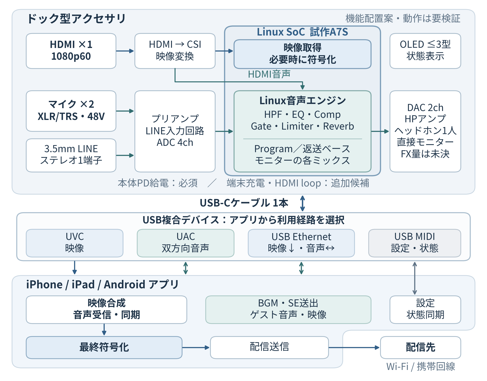

# Streaming Dock — 仕様と進捗

**スマートフォン／タブレットに、HDMIとマイク2本の配信機能を追加する。**

ikakim のモバイルアプリを中心に、HDMI キャプチャ、音声入力と Linux ミキサー、直接モニター、状態表示を備えた Dock を組み合わせる企画です。トーク・対談、音楽・演奏、イベントを優先し、ゲームは 1080p60 で使える範囲を対象にします。

仕様基準：**構想仕様 v0.6**  
最終更新：**2026年11月20日**  
仕様書の管理先：**このリポジトリの `docs/streaming-dock/`**  
親 Issue：[全体管理 #9](https://github.com/windrorg/ikakim/issues/9)

## 製品の構成

| 部分 | 担当する役割 |
| --- | --- |
| Dock | HDMI 1 入力・1080p60、Mic 2 入力・48V、独立した 3.5 mm Stereo LINE、Linux での mix / FX、ヘッドホン 1 人分の直接モニター、小型 OLED |
| iPhone / iPad / Android アプリ | 映像の切替・合成、Dock 音声の受信と同期、BGM / SE の送出、遠隔ゲストの音声・映像、最終符号化、Wi-Fi / 携帯回線での配信 |
| Dock とアプリの接続 | USB-C ケーブル 1 本。UVC / UAC、USB Ethernet、USB MIDI を使い、端末と用途に応じて転送経路を選ぶ |
| ゲスト参加 | アプリ内 WebRTC と招待リンク。Cloudflare TURN を使い、初期実証はゲスト 1 名で音声と映像を扱う |

基本構成と要求は [製品要件](requirements.md)、バスの分担は [音声設計](audio.md)、接続方式は [USB・IP・MIDI](usb-and-protocols.md) を参照してください。端末と通信方式の互換性、全負荷での性能は実機検証を進めます。

税込 5 万円以下・直販中心・約 3,000 台を事業条件とし、AC アダプターとケーブルは同梱しない方針です。量産方式、製造費、アプリ / 通話の料金は検討中です。[ハードウェアと事業条件](hardware.md)

## 全体図

図は機能の配置案です。FX 6 種は目標範囲として評価し、処理負荷や日程に応じて機能を調整します。HDMI パススルーと端末充電は実現を目指す機能で、初回バラック試作の必須条件には含めません。

音声は Dock でミックスします。App から BGM / SE とゲスト音声を別々に受信し、Dock から配信用 Program とゲスト音声を含まない Local/Media を別々に送信する設計案です。Program 全体を Dock に再送信せず、ゲストへの N−1 は App で構成します。直接モニターと通話返送には配信用の同期遅延を一律に適用しません。[音声バスの詳細](audio.md)

## 要求と設計の凡例

| 区分 | 意味 | 読み方 |
| --- | --- | --- |
| **C** | 確定した要求・方針 | ユーザーが示した必須要件に加え、「可能なら実現したい」と確定した希望機能も含む。必須度は各項目の本文を読む。実装済みや性能保証を意味しない。 |
| **P** | 設計提案・暫定値 | 初期設計や実証の開始条件。採用・保証を決めた値ではない。 |
| **O** | 未決定 | 選択肢、仕様値、採用範囲を今後決める。 |
| **V** | 実機検証待ち | 機器・OS・BSP・接続を組み合わせて成立や性能を確認する。C や P と併記できる。 |

「要求が決まっているか」と「実装・実証が済んでいるか」は別に管理します。たとえば HDMI 1080p60 は C ですが、A7S での取得から端末への転送までの成立は V です。端末充電は C の希望機能であり、実現済みではありません。

## 仕様の目次

9 つの分野に分け、実装状況を別ページで管理します。各ページの章番号は v0.6 文書との対応を残しています。

| ページ | 読む内容 |
| --- | --- |
| 1. [製品コンセプトと要求仕様](requirements.md) | 用途、要求一覧、競合との比較軸 |
| 2. [ハードウェアと事業条件](hardware.md) | A7S / HDMI、音声回路、PD、形状、価格と量産 |
| 3. [USB・IP・MIDI の接続仕様](usb-and-protocols.md) | 複合デバイス、転送経路、音声・映像の通信仕様、制御と状態 |
| 4. [音声バスと Linux 処理](audio.md) | Program / Local/Media、return、直接モニター、FX、クロック |
| 5. [遠隔ゲストと Cloudflare](guest.md) | 招待、WebRTC / TURN、ゲスト映像、返送、同期、利用費 |
| 6. [ikakim との統合](app-integration.md) | 既存アプリからの変更、native I/O、時刻、対応端末 |
| 7. [Cubie A7S・VRC-01 の初期試作](prototype.md) | 接続、電源、CSI 変換、VRC-01 の設定と先行試験 |
| 8. [実証の順序と判定条件](validation.md) | 段階別の試験、測定目標、連続運転、全負荷 |
| 9. [技術資料と改訂記録](references.md) | 一次資料、参照コード、変更履歴 |
| [実装状況と検証の記録](implementation-status.md) | 既存 #1〜#8 の履歴、コードの到達点、過去の試験、追加実証 |

## 現在の開発状況

配信エンジンの基盤はあり、Dock の製品要件と初回試作方針がまとまった段階です。コードの参照基準は [`37823d3`](https://github.com/windrorg/ikakim/commit/37823d312d07ca8b3e39b34468b77ce80e1aa81c)（2026年11月14日）。実装と記録の根拠は [実装状況](implementation-status.md) に固定コミットのリンクでまとめています。

| 領域 | 現在の状態 |
| --- | --- |
| 共通エンジン | 音声ミキサー、GPU 合成、RTMPS / ABR、HTTP / WS・MSE の基盤コードがある。過去の macOS / Linux VM の試験報告もある。 |
| Linux ハードウェア | RK3588 / S905X2 向けコードはあるが、旧 Issue の記録には実機未接続が明記されている。A7S / A733・C790 は新規実証。 |
| モバイル | iOS 内蔵入力の接続と Android のホスト / 試験用基盤がある。Android は実カメラ起動と実音声 AAC 等の本番接続が不足する。 |
| Dock 統合 | 4 バス、Linux FX、複合 USB、IP 入力、MIDI、WebRTC ゲスト AV と同期を実装・実証する。 |
| 初回試作 | Cubie A7S と所有する VRC-01 を使用する計画。VRC-01 は暫定 USB 2ch 入力であり、製品のマイク2本＋ステレオLINEの独立4入力の証明にはしない。 |

既存 #1〜#8 は closed / completed の履歴として維持します。その状態から Dock 製品の完成や両モバイル OS の実機検証済みを推定せず、新しい Issue で追加の実装と判定条件を管理します。

## 段階ロードマップ

日程はまだ固定せず、前段の測定結果から次の設計を判断します。詳細な条件は [検証計画](validation.md) と [初期試作](prototype.md) に記載します。

| 段階 | 目的 | 次へ進むための根拠 |
| --- | --- | --- |
| 0. A7S の接続基盤 | OS / BSP、電源、USB Host と Gadget、管理経路を固定 | 起動・接続記録、UDC と ALSA の認識、単独符号化の結果 |
| 1. Linux 音声 | VRC-01 で基本 mix、直接モニター、4 論理バス、FX を順に評価 | 信号経路の分離、ループなし、遅延・xrun・FIFO の記録 |
| 2. HDMI と端末転送 | C790、CSI 変換、1080p60、UVC / IP、UAC / MIDI を接続 | 取得から端末までの fps / 欠落、複合列挙、配信回線との共存 |
| 3. ゲストの音声・映像 | 招待から受信・返送、N−1、Dock 往復後の A/V 同期まで統合 | 初期 1 名で直接 / TURN、音の二重加算なし、同期と再接続の記録 |
| 4. 製品回路と全負荷 | 独立 4 ADC / HP、48V、採用 FX、全映像、電源・放熱を統合 | 対象機種ごとの長時間運転、遅延・温度・電力、音質の測定 |
| 5. 量産範囲の決定 | 対応機種、保証性能、筐体、追加機能、価格を確定 | 試作結果、製造見積、検査方法、運用費を踏まえた採否 |

音声の検証を先行させる方針ですが、遠隔ゲスト映像も初期想定に含めます。ゲスト 1 名は PoC 条件、720p30 は仮の開始条件であり、製品の人数・画質上限は未決定です。

## Issue 一覧

各Issueは計画・未着手／実証待ちとして開始します。担当者と期限は未定です。

| Issue | 課題 | 段階 | 統合・受入で参照する Issue |
| --- | --- | --- | --- |
| [#10](https://github.com/windrorg/ikakim/issues/10) | 通信仕様とMIDI設定・状態同期・再接続時の復元を定義する | 基盤・通信仕様 | なし |
| [#11](https://github.com/windrorg/ikakim/issues/11) | Cubie A7S＋VRC-01でバラック試作を構築し、Linux音声往復とUSBの役割を確認する | 基盤・通信仕様 | なし |
| [#12](https://github.com/windrorg/ikakim/issues/12) | 既存モバイル本番I/Oの不足を解消し、代表端末で実映像・実音声を配信する | 基盤・通信仕様 | なし |
| [#13](https://github.com/windrorg/ikakim/issues/13) | A7S＋C790でHDMI 1080p60の取得・符号化と独立クロックのHDMI音声入力を実証する | 単体実装・実証 | [#11](https://github.com/windrorg/ikakim/issues/11) |
| [#14](https://github.com/windrorg/ikakim/issues/14) | Linux音声サービスでmix・FX・直接モニター・返送ベースとクロック同期を実装する | 単体実装・実証 | [#11](https://github.com/windrorg/ikakim/issues/11)、[#10](https://github.com/windrorg/ikakim/issues/10) |
| [#15](https://github.com/windrorg/ikakim/issues/15) | A7Sの複合USB GadgetでUVC・UAC・Ethernet・MIDIを同時評価する | 単体実装・実証 | [#11](https://github.com/windrorg/ikakim/issues/11)、[#10](https://github.com/windrorg/ikakim/issues/10) |
| [#16](https://github.com/windrorg/ikakim/issues/16) | Mic 2＋独立ステレオLINE・48V・HP用の4ADC／2DAC回路とSoC接続を設計・実証する | 単体実装・実証 | [#11](https://github.com/windrorg/ikakim/issues/11) |
| [#17](https://github.com/windrorg/ikakim/issues/17) | USB PD受電・音声用電源を設計し、端末充電を追加できる条件を判断する | 単体実装・実証 | なし |
| [#18](https://github.com/windrorg/ikakim/issues/18) | OLED状態表示とスマートフォン〜iPadを保持するDock筐体を試作する | 単体実装・実証 | なし |
| [#19](https://github.com/windrorg/ikakim/issues/19) | 任意機能の1080p60 HDMIパススルーを評価し、搭載可否を判断する | 単体実装・実証 | なし |
| [#20](https://github.com/windrorg/ikakim/issues/20) | 税込5万円以下・直販約3,000台の条件で量産構成と原価成立性を評価する | 量産・事業条件 | なし |
| [#21](https://github.com/windrorg/ikakim/issues/21) | iPhone・iPad・AndroidのUVC／UAC／IP／MIDI対応を実機で比較する | モバイル統合 | [#10](https://github.com/windrorg/ikakim/issues/10)、[#15](https://github.com/windrorg/ikakim/issues/15) |
| [#22](https://github.com/windrorg/ikakim/issues/22) | IP映像・4音声バスの転送とクロック同期・ストリーム復帰を実証する | モバイル統合 | [#10](https://github.com/windrorg/ikakim/issues/10)、[#13](https://github.com/windrorg/ikakim/issues/13) |
| [#23](https://github.com/windrorg/ikakim/issues/23) | 接続管理・権限・入力経路選択と配信回線の併用を実装する | モバイル統合 | [#10](https://github.com/windrorg/ikakim/issues/10)、[#21](https://github.com/windrorg/ikakim/issues/21)、[#22](https://github.com/windrorg/ikakim/issues/22)、[#12](https://github.com/windrorg/ikakim/issues/12) |
| [#24](https://github.com/windrorg/ikakim/issues/24) | アプリの4音声バスを統合し、BGM／SEの送信経路を分離する | モバイル統合 | [#10](https://github.com/windrorg/ikakim/issues/10)、[#21](https://github.com/windrorg/ikakim/issues/21)、[#22](https://github.com/windrorg/ikakim/issues/22)、[#23](https://github.com/windrorg/ikakim/issues/23)、[#14](https://github.com/windrorg/ikakim/issues/14) |
| [#25](https://github.com/windrorg/ikakim/issues/25) | Cloudflareで招待・シグナリング・期限付きTURN資格情報を提供する | ゲスト統合 | なし |
| [#26](https://github.com/windrorg/ikakim/issues/26) | 招待リンクによるゲスト1人の音声・映像通話とmix-minus・同期を実証する | ゲスト統合 | [#24](https://github.com/windrorg/ikakim/issues/24)、[#22](https://github.com/windrorg/ikakim/issues/22)、[#25](https://github.com/windrorg/ikakim/issues/25) |
| [#27](https://github.com/windrorg/ikakim/issues/27) | HDMI 1080p60・Linux音声・ゲスト映像・配信を統合し、同期・連続運転・障害復帰を測定する | 製品統合・検証 | [#11](https://github.com/windrorg/ikakim/issues/11)、[#13](https://github.com/windrorg/ikakim/issues/13)、[#14](https://github.com/windrorg/ikakim/issues/14)、[#15](https://github.com/windrorg/ikakim/issues/15)、[#26](https://github.com/windrorg/ikakim/issues/26)、[#12](https://github.com/windrorg/ikakim/issues/12) |
| [#28](https://github.com/windrorg/ikakim/issues/28) | 未決の製品仕様・任意機能・対応端末・原価と課金を証跡に基づき決定する | 製品判断 | [#27](https://github.com/windrorg/ikakim/issues/27)、[#20](https://github.com/windrorg/ikakim/issues/20)、[#16](https://github.com/windrorg/ikakim/issues/16)、[#17](https://github.com/windrorg/ikakim/issues/17)、[#18](https://github.com/windrorg/ikakim/issues/18)、[#19](https://github.com/windrorg/ikakim/issues/19)、[#21](https://github.com/windrorg/ikakim/issues/21)、[#26](https://github.com/windrorg/ikakim/issues/26) |

依存関係は統合・受入判定までに必要な成果を表します。調査、通信仕様の調整、テスト信号やmockを使った単体実装は並行して進められます。

## 進捗の運用

仕様書はこのディレクトリで一元管理し、作業と議論は Issue、実装差分は PR で管理します。仕様を変更する場合は C / P / O / V と変更理由を更新し、関連 Issue・PR から参照します。

完了の根拠として、チェックボックスに加えて次の記録を保存します。

1. **実装:** PR / commit と、達成した要求・残る制約。
2. **環境:** 基板版、OS / kernel / BSP、端末 / OS、接続図、映像・音声形式、使用 codec。
3. **試験:** 実行手順、入力信号、負荷条件、実行時間、スキップした項目。
4. **測定:** その Issue の完了条件に対応する fps / drop、遅延・A/V ずれ、xrun、温度・電力等のログ。

mock / 仮想入力 / VM / 実機の区分を記録し、実証範囲を越えた表現を避けます。完了した Issue と [実装状況](implementation-status.md) を対応させ、試験結果から仕様値を変更したときは [要求](requirements.md) と [検証条件](validation.md) も更新します。

