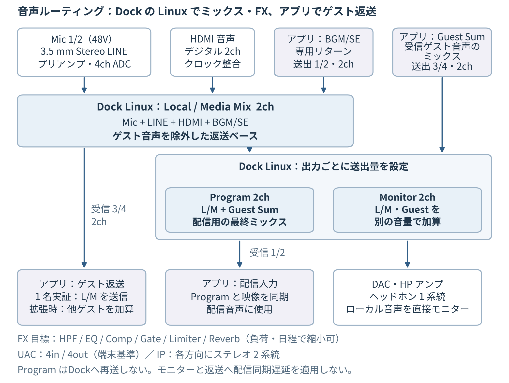

# 音声バスとLinux処理

[仕様と進捗の入口](README.md)

基準：構想仕様 v0.6、2026年11月20日。C＝確定要求、P＝設計提案、O＝未決定、V＝実機検証待ち。確定要求は実装済みを意味しません。

## 5  音声バスとDock内ルーティング

最終配信用ミックスをDockのLinuxで完成させる。BGMとゲストは別々に戻し、ゲスト自身の声を除いた返送用の音もDockから受け取る。ローカル入力の直接モニターは端末を往復しない。

図2  Linux上の音声処理案  L/M＝LOCAL_MEDIA。FXの搭載範囲は実証で調整する。

| バスID | 方向 | 内容／UACの候補割当て |
| --- | --- | --- |
| PROGRAM | Dock → App | 配信全体。マイク＋LINE＋HDMI＋BGM／SE＋ゲスト。Capture 1–2ch。 |
| LOCAL_MEDIA | Dock → App | 全ゲストを除いた返送ベース。BGM／SEは含む。Capture 3–4ch。 |
| MEDIA_RETURN | App → Dock | アプリ内BGM／SE専用。OS全体やProgramは含めない。Playback 1–2ch。 |
| GUEST_RETURN | App → Dock | ゲスト音声、または複数ゲストの合計。Playback 3–4ch。 |

Capture／Playbackは端末側から見た方向。4バスは各2chの論理単位であり、4つのUAC functionを作る意味ではない。IPでも同じ役割を維持する。

## 6  遠隔ゲストの返送と参加方式

### 初期からゲストの音声と映像を扱う

C  ikakim内のWebRTC通話に招待リンクから参加する方式を基本とし、最初はゲスト1人で実証する。STUN／TURN等はCloudflareを利用する。P  直接P2P接続と必要時のTURN中継、Workers／Durable Objectsによる接続管理を[第9章](guest.md)で具体化する。ゲスト映像は初期製品の想定に含める。製品の最大人数は未決定。

### ゲスト自身の音声を返さない

1人のゲストにはLOCAL_MEDIAを送る。アプリが受信したゲスト音をGUEST_RETURNでDockへ渡し、DockのLinuxがPROGRAMとヘッドホン用ミックスに加える。配信ではPROGRAMを使い、BGMやゲストをもう一度足さない。

| 処理 | 設計上のルール |
| --- | --- |
| 返送ベース | ゲスト音声とゲスト由来のリバーブ残響をLOCAL_MEDIAへ混ぜない。ローカル用FXとゲスト用FXの戻り先を分ける。 |
| 遅延の分離 | 配信用の入力別・PROGRAM全体の同期遅延を、返送とmonitorへ適用しない。映像はアプリで受信・合成。ゲスト音声のDock往復・FX分を映像の時刻へ反映。 |
| 音声入出力の管理 | 端末側の一つの音声エンジンがDockと通話PCMを管理。WebRTCが別途USBマイクを開いたり、標準再生を重ねたりしない。 |
| 音量の責務 | ゲスト音量はアプリで保持し、DockのGuest全体音量と返送量の関係を定義。PROGRAMから元のゲスト音を波形減算しない。 |

音声はWebRTCのネイティブ入出力拡張点へ統合する。[S42](references.md#s42) 映像は受信フレームの時刻を保ってikakimの合成入力へ渡す。初回はゲスト720p30を上限候補とし、HDMI 1080p60と別に負荷を評価する。

### 複数ゲストは後続の設計範囲

複数人へ拡張する場合、アプリがゲストごとのPCMを保持し「返送i＝LOCAL_MEDIA＋宛先i以外のゲスト」を作れる。個別PCM取得と宛先別送信に対応した実装が条件。SFUが他ゲスト音を直接配送する方式では重複加算せず、返送の分担を変更する。PoCの1人を製品の人数上限にはしない。

### 通話と音楽配信の処理を分ける

ミックスマイナスは信号の循環を防ぐが、スピーカーからマイクへの音響エコーは別問題。初期実証はホスト・ゲストともヘッドホンで行う案とし、スピーカー利用時のAECは通話経路で評価する。音楽配信全体へ通話用AGC／ノイズ抑制を一律適用しない。

Zoom／LINE等の既存アプリ連携は標準範囲から分けて扱う。Appleの通話中録音セッションとAndroidの同時入力／再生音取得には制約があり、別構成を追加する場合は対象サービスごとに検証する。[S38–S40](references.md#s38)

## 8  Linux音声処理と機能縮小の方針

C  音声mix／FXはまずLinux上で処理する。日程または処理負荷が厳しい場合は、機能を減らす方法を優先する。P  専用の常駐音声サービスとALSAを基本案とし、映像処理・制御画面・ネットワーク処理から実行経路を分ける。

### 処理の期限を守るための実装案

| 要素 | 提案 |
| --- | --- |
| 音声I/O・処理 | 48kHzを基準とし、固定した小ブロックでADC取得、mix／FX、DAC出力。必要なポートの全二重動作とALSAの実period／bufferを取得する。[S52](references.md#s52) |
| スケジューリング | SCHED_FIFO、音声メモリの事前確保・ロック・事前アクセスを検討。BSPでPREEMPT_RTを使えるかも評価する。[S55–S57](references.md#s55) |
| 制御との分離 | 音声処理中の動的確保、ログ／ファイル／通信I/O、不確定なmutex待ちを避ける。係数準備・保存・OLED・MIDIは別経路にし、更新をブロック境界で適用する。[S53](references.md#s53) |

64 frames／48kHz＝1.33ms、128 frames＝2.67msは1ブロック分の時間であり、ADC→DAC総遅延ではない。変換器、capture／playbackのキュー、起床・処理、SRC、FXの先読みを含めて測定する。スケジューラ設定だけで性能を保証しない。

### 機能を縮小する順序の提案

| 段階 | 調整するもの | 維持するもの |
| --- | --- | --- |
| 1 | リバーブの共有数、アルゴリズム、処理量。必要なら初期版からの搭載を後ろへ移す。 | マイク／LINE／HDMI／BGM／ゲストの基本mix、返送、HP。 |
| 2 | 入力・出力ごとの独立FX数、EQバンド数、プリセットの種類。使用頻度の高い処理へ限定。 | 直接モニターの遅延、48V、音量／mute、1080p60。 |
| 3 | メーター更新、周辺処理、複数ゲスト人数、ゲスト画質／fps、返送映像の処理範囲を調整。 | 初期ゲスト映像、時計整合、音切れ対策、本人の音を返さない構造。 |

これは製品の機能範囲を決めるための順序案。FXの縮小順は未承認であり、オンエア中に自動で音を変える機能は初期前提にしない。バッファ増大だけで遅延目標を超えないよう確認する。

### 時計と障害時の動作

ローカルcodecを基準とし、HDMI・UAC・IP戻りの時計差をFIFOと時刻で監視する。USBのfeedback等と、必要なソフトウェアASRCを組み合わせる。libsamplerate等の変換APIに加え、変換比の制御が必要。[S16,S33,S54](references.md#s16)

直接モニターは端末を往復しないがLinux処理を通る。USB切断時もローカル音を継続する設計と、音声プロセス停止時の無音化・再起動・フェード復帰を分けて実証する。
