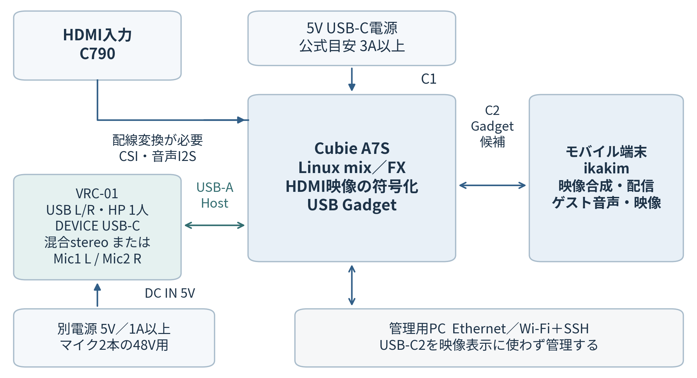

# Cubie A7S・VRC-01の初期試作

[仕様と進捗の入口](README.md)

基準：構想仕様 v0.6、2026年11月20日。C＝確定要求、P＝設計提案、O＝未決定、V＝実機検証待ち。確定要求は実装済みを意味しません。

## 16  Cubie A7SとVRC-01のバラック接続案

C  初回試作はCubie A7S、手持ちのVRC-01あり。P / V  VRC-01を暫定音声IFとしてLinuxのmix／FXを立ち上げる。公式ブロック図のUSB出力は混合済みL/Rであり、製品の独立4入力を満たす機器とは扱わない。[S61](references.md#s61)

図3  VRC-01を使う試作案  Linux認識、C2 Gadget、C790接続は実機確認が必要

| 部材 | 初回に用意する条件 |
| --- | --- |
| A7Sと起動媒体 | RAM、eMMC有無、基板版、OSイメージを記録。microSDは公式推奨32GB以上を目安。C1に5V電源、公式目安3A以上。冷却も確認。[S58–S59](references.md#s58) |
| VRC-01の接続 | DEVICE USB-C → A7SのUSB-A Host。データ対応A–Cケーブル。PHONES／HEADSETへヘッドホン。端末はVRC-01へ直結せずA7S側へ。 |
| VRC-01の電源 | DC IN 5Vへ別の5V／1A以上電源。USBバス給電ではMIC 2の48Vを使えないため、マイク2本のファンタム試験は外部給電する。[S62](references.md#s62) |
| 映像と端末接続 | C790＋4lane配線変換、HDMI信号源、データ対応USB-Cケーブル。PCでGadgetを確認後、USB-C端末へ進む。 |

VRC-01はstereo／2マイク分離試験用。最終製品の物理4ADC／2DAC、端末との論理UAC 4in／4outは別仕様として維持する。VRC-01内蔵monitorを切り、Linuxを通った音だけを聴く。設定と確認手順は[第18章](prototype.md)。

## 17  バラック試作で先に確認する接続条件

### USBの役割と電源

USB-C1を5V電源、USB-C2を端末向けGadget、USB-Aを音声IFのHostとする案。公表仕様とV1.10回路図では別経路を確認できる。端末Host／A7S Deviceの役割とVBUS方向、C2のUDC、BSPと複合functionの同時動作を実証する。[S58,S60](references.md#s58)

Gadget試験中の管理はEthernet／Wi-Fi＋SSH、必要に応じUARTを使う。初回は端末充電とDisplayPort表示を加えず、電源とデータの役割を固定する。C2で成立しない場合はBSPと給電経路を先に再検討し、GPIO給電への単純な置換は手順に含めない。

### C790のCSI接続

A7Sは31pin・0.3mm・4lane、C790の4lane側は22pin・0.5mm。コネクタ形状、接点面、電源、I2C、reset、差動信号を照合した変換基板／FFCを用意する。高速差動配線をブレッドボードや長いジャンパ線で延長する構成は避ける。[S11,S13,S58](references.md#s11)

| 信号 | A7S V1.10のJ5接続先 |
| --- | --- |
| CSI Clock N／P | 17／18番。8／9番はこの回路図でNC。 |
| CSI Data N／P | D0＝14／15、D1＝11／12、D2＝5／6、D3＝2／3番。 |
| 対象と根拠 | V1.10回路図の10 CAMERA、J5。実物基板版とC790側のpin番号・接点面を照合してから配線図を確定する。[S60](references.md#s60) |

Raspberry Pi向け設定をそのまま適用せず、TC358743ドライバー、A733 CSI受信系、Device Tree、YUV形式、4laneリンクと1080p60のタイミングを確認する。C790のHDMI音声は別のI2S経路で取り込む。映像のみの成功を音声取得の成功に数えない。[S13–S16](references.md#s13)

### 最初の起動で採取する記録

OSとkernel、基板版、USB接続図、UDC名、USBの役割と接続速度、ALSAの入出力数／形式、OMX encoderの有無を記録する。確認コマンド例は uname -a、ls /sys/class/udc、lsusb -t、arecord -l、aplay -l、cat /proc/asound/card*/stream*、gst-inspect-1.0 omxh264videoenc。

HDMIを接続する前にテスト映像のH.264符号化を確認し、続いてCSI入力と接続する。公式OMX例は解像度／fps未指定のため、1080p60の明示設定と出力fps実測を追加する。[S15](references.md#s15) 最終的には[第14章](validation.md)の全負荷試験へ進む。

## 18  VRC-01で先行する音声実証

公式資料はPC用USB音声IFとしての使用を説明する。Linux対応、USBクラス版、PCM形式と同時録再は未確認。接続後のALSA表示と実録再で判定し、アプリ仕様の24bit／48kHzをVRC-01のUSB保証値へ転記しない。[S25,S62](references.md#s25)

| 試験モード | できること／条件 |
| --- | --- |
| 混合stereo | Mic 1／2とLINE等をVRC-01で混ぜ、LinuxへL/Rで取得。基本mix、返送、負荷の先行試験用。各アナログ入力の独立FXはできない。[S61](references.md#s61) |
| マイク2本を分離 | USERを消灯しMIC 1/2 STEREOをON。Mic 1＝L、Mic 2＝R。LINE、内蔵／ヘッドセットmic、内蔵FXを止め、Linuxで2本のmonoに分離する案。[S63,S65](references.md#s63) |
| 製品の独立4入力 | Mic 1、Mic 2、LINE L、LINE Rの同時独立取得はこの暫定構成の検証範囲外。4ADC／2DACとI2S／TDMを後段で実証する。 |

### Linux処理を測るための初期設定

| 設定 | 試験時の状態 |
| --- | --- |
| LOOPBACK／monitor | LOOPBACKを左いっぱいでOFF、DIRECT MONITORをOFF。USB再生が再びcaptureへ入らず、Linuxの戻りだけを聴く状態にする。[S61,S63](references.md#s61) |
| 内蔵処理 | COMP／LIMITER、REVERB、LIP SYNC DELAYを最小。ECHO CANCEL、AUTO LEVELER、LOW CUT、DE-ESSERをOFF。USER消灯で標準割当を確認。[S63](references.md#s63) |
| 毎起動のゲート | ノイズゲートは起動時ONへ戻る。USERを押しながらASSIGNABLE DECK［1］を押し、緑＝OFFを確認。赤＝ON。[S64](references.md#s64) |
| 入力と音量 | 未使用入力を下げ、MAINと入力faderの値を記録。聴取音量はPHONESで低い状態から調整。Mic 1／2分離時はLINEと内蔵micを止める。 |

### 最初に確認する3つの信号経路

①アナログ入力を止めてLinuxから再生し、その再生音がUSB録音に戻らない。②マイク入力中にLinuxの再生を止めると、HPのマイク音も止まる。③Mic 1／2へ片方ずつ入力し、USB録音のL／Rが独立している。

### ALSA認識から全負荷へ進む

arecord -l／aplay -lと /proc/asound/card*/stream* で実レート・形式・ch数を確認し、同時録再を実行。FX、端末4バス、HDMI負荷を順に加えてxrunと遅延を測る。追加入力をファイルで模擬しても、4ADCの成立証明にはならない。

内蔵処理を切っても未加工ADC出力とは見なさない。VRC-01を含む遅延と音質はこの暫定系の測定値。量産音声回路へ置換後に再評価する。VRC-01の操作ボタンやMIDIの再利用も未確認。
